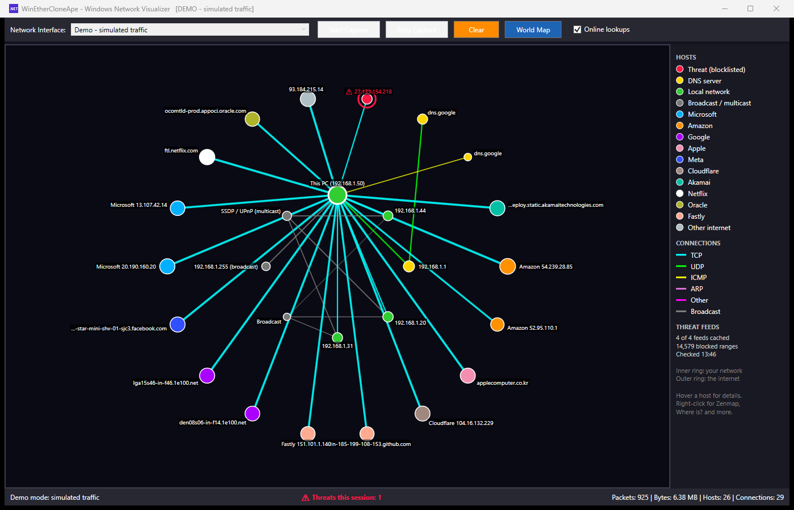

# WinEtherCloneApe

[](https://www.microsoft.com/windows)
[](https://dotnet.microsoft.com/)
[](https://docs.microsoft.com/en-us/dotnet/csharp/)
[](LICENSE.txt)

**A real-time network traffic visualizer for Windows** - bringing the idea of Linux's EtherApe to Windows, with threat detection, a world map and Nmap/Zenmap built in.



## What's new in 2.0

- **Threat detection** - every internet address is checked against free public blocklists. Threats are the only red hosts, with a pulsing ring, a counter in the status bar and a log file.
- **Color palette** - DNS servers, your local network, broadcast/multicast, the top 10 internet companies and everything else each get their own color.
- **Right-click any host** for:
  - **Interrogate with Zenmap** - opens Zenmap with the IP filled in and starts the scan profile you pick
  - **Where is?** - opens a map showing where the address is, with a line from your own location
  - **Check reputation online** - AbuseIPDB, VirusTotal, Shodan, ARIN Whois
  - **Threat details**, **Copy IP address**, **Copy host name**
- **World Map** button - every internet host you are talking to, on one map
- **Hover any host** for owner, network (ASN), location, ports, traffic and threat status
- Inner ring for your network, outer ring for the internet, grouped by color, with smooth movement
- Broadcast and multicast traffic drawn in grey
- Stability: shapes are kept and updated instead of redrawn 10 times a second, all updates happen on one thread, DNS lookups have timeouts

## Colors

| Hosts | Color |
|---|---|
| **Threat** (on a blocklist) | Red, pulsing ring |
| DNS server | Yellow |
| Local network device | Green |
| Broadcast / multicast | Grey |
| Microsoft | Sky blue |
| Amazon | Orange |
| Google | Violet |
| Apple | Pink |
| Meta | Indigo |
| Cloudflare | Tan |
| Akamai | Teal |
| Netflix | White |
| Oracle | Olive |
| Fastly | Peach |
| Other internet host | Light grey-blue |

| Connections | Color |
|---|---|
| TCP | Cyan |
| UDP | Lime |
| ICMP | Yellow |
| ARP | Orchid |
| Other | Magenta |
| Broadcast / multicast | Grey |

Companies are recognized from the network that owns the address (its ASN), its host name, or its registered organization name.

## Threat feeds

Downloaded at startup, cached in `%LOCALAPPDATA%\WinEtherCloneApe\threatfeeds`, refreshed when older than 12 hours (the cached copy is used when offline):

- [FireHOL Level 1](https://iplists.firehol.org/?ipset=firehol_level1) - known attackers, malware hosts and hijacked networks
- [Feodo Tracker](https://feodotracker.abuse.ch/) - botnet command-and-control servers
- [Emerging Threats](https://rules.emergingthreats.net/) - compromised hosts
- [CINS Army](https://cinsscore.com/) - hosts seen attacking networks

Private, multicast and reserved addresses are never flagged. Every threat seen is appended to `%LOCALAPPDATA%\WinEtherCloneApe\threats.log`.

## Online lookups

With **Online lookups** ticked, internet addresses are sent to [ip-api.com](https://ip-api.com) (free, no key, plain HTTP) to find their owner and location. This powers the company colors, tooltips, Where is? and the World Map. Untick it to keep addresses on your PC; host-name matching and threat detection still work.

## Installation

Download from the [Releases](https://github.com/Powellga/WinEtherCloneApe/releases) page. Both downloads include .NET, so nothing else from Microsoft needs installing.

- **`WinEtherCloneApe-x.y.z-Setup.exe`** (recommended) - installs for the current user without an admin prompt (or for all users if you choose), adds Start Menu and optional desktop shortcuts, installs WebView2 for the maps if it is missing, checks for Npcap and offers its download page, and adds an uninstaller to Apps & features.
- **`WinEtherCloneApe-x.y.z-portable.exe`** - one file, no install. Put it anywhere and run it.

### You also need
- Windows 10 (1809 or later) or Windows 11, 64-bit
- [Npcap](https://npcap.com/#download) - the free capture driver. Install it once (keep "WinPcap API-compatible Mode" ticked). Its license does not allow bundling it, so the installer links to it instead.
- [Nmap](https://nmap.org/download#windows) with Zenmap - optional, for the Zenmap menu
- Administrator rights - the app asks for them when it starts

### Run
Start **WinEtherCloneApe** from the Start Menu. The internet-facing adapter is picked for you; press **Start Capture**.

## Building from Source

```bash
git clone https://github.com/Powellga/WinEtherCloneApe.git
cd WinEtherCloneApe
dotnet build -c Release
```

Or open `WinEtherCloneApe.sln` in Visual Studio 2022.

To build the release files (portable exe and installer) into `artifacts\`:

```powershell
winget install JRSoftware.InnoSetup --scope user   # once
.\build-release.ps1
```

To try the display without capturing (no admin needed when started through `dotnet`):

```bash
dotnet bin/Release/net8.0-windows/WinEtherCloneApe.dll --demo
```

Add `--open-map` to have the World Map open after 20 seconds.

### NuGet packages
- SharpPcap 6.3.1 - packet capture
- PacketDotNet 1.4.8 - packet parsing
- Microsoft.Web.WebView2 - maps

## Project layout

```
App.cs             Entry point and command line options
MainWindow.cs      UI, capture, rendering, right-click menu
Models.cs          NetworkNode, NetworkEdge, GeoInfo
NodePalette.cs     Colors, top-10 company definitions (ASNs, host names)
ThreatIntel.cs     Blocklist download, cache and lookup
LookupServices.cs  Reverse DNS and ip-api.com lookups
MapWindow.cs       Leaflet map inside WebView2
ExternalTools.cs   Zenmap and browser launching
IpUtil.cs          IP helpers and this PC's network facts
AppSettings.cs     Settings in %LOCALAPPDATA%\WinEtherCloneApe\settings.json
```

## Known Limitations

- Threat feeds are IPv4 only
- Only scan hosts you own or have permission to scan - scanning other people's servers with Zenmap can break their terms of service or the law
- Some addresses have no host name (no reverse DNS record)
- Busy networks can still have overlapping labels; hover for the full details

## License

MIT - see [LICENSE.txt](LICENSE.txt).

## Acknowledgments

- Built by Gregg Powell (g.a.powell@protonmail.com)
- Inspired by [EtherApe](https://etherape.sourceforge.io/) for Linux
- [SharpPcap](https://github.com/chmorgan/sharppcap) and [PacketDotNet](https://github.com/chmorgan/packetdotnet) by Chris Morgan
- Maps by [Leaflet](https://leafletjs.com/) with Esri dark gray tiles
- Threat data from FireHOL, abuse.ch, Proofpoint Emerging Threats and CINS Score
