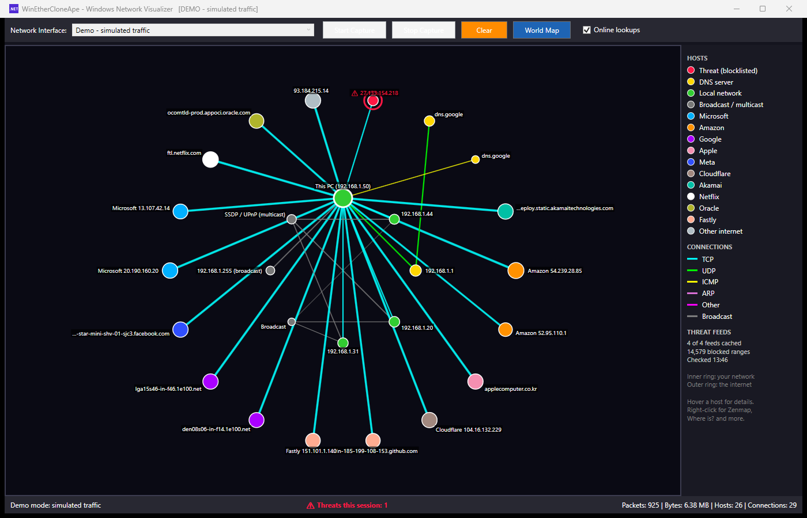

# WinEtherCloneApe

[](https://www.microsoft.com/windows)
[](https://dotnet.microsoft.com/)
[](https://docs.microsoft.com/en-us/dotnet/csharp/)
[](LICENSE.txt)

**A real-time network traffic visualizer for Windows** - bringing the idea of Linux's EtherApe to Windows, with threat detection, a world map and Nmap/Zenmap built in.



## What's new in 2.3

- **Thorough threat checking** - IPv6 addresses are now checked, DNS lookups of malware and phishing domains are caught, every address seen this session is re-checked when the lists update, lists refresh while the app runs, and nothing is skipped under heavy traffic. Three new lists: HaGeZi Threat Intelligence (addresses and domains), Spamhaus DROP IPv6 and Phishing Army.
- **Threat report window** - which of your devices talked to each threat, who started the conversation, ports, traffic and timing, plus how much was checked. Exports to CSV.
- **Threat alerts** - taskbar flash and warning sound when a new threat appears

## What's new in 2.2

- **Zoom and move around the map of hosts** - scroll the mouse wheel to zoom in where the pointer is, drag with the left mouse button to move around, double-click an empty spot (or press **Reset View**) to see everything again. On a touch screen, pinch to zoom, drag with a finger, and press and hold a host for its menu. Keyboard: `+`, `-` and `0`.
- Zooming spreads the hosts apart while their dots and labels stay readable, so a crowded ring opens up instead of just getting bigger. Long host names show in full when zoomed in.
- **Details...** on the right-click menu shows the hover information in a window (handy on touch screens)

## What's new in 2.1

- **Packet capture for one host** - right-click a host and choose **Packet capture...** to record every packet to and from it while the main capture runs. A Wireshark-style window lists the packets live (time, source, destination, protocol, length, TCP flags), shows each packet's decoded layers and hex bytes, and saves a standard `.pcap` file or opens it straight in Wireshark. Saved captures go to `C:\Users\<you>\WinEtherCloneApe Captures` (not Documents, which is often synced to OneDrive).
- **Connect with browser** - opens `http://<ip>/` (port 80) or `https://<ip>/` (port 443), handy for routers, printers and cameras
- **Connect with SSH** - asks for the user name and port (remembered for next time) and opens the session in Windows Terminal, using the SSH client built into Windows
- **Tailscale** - devices on your tailnet are lavender with a dashed ring. When the Tailscale app is installed, each one is labelled with its tailnet name, and the tooltip shows its OS and whether it is online. MagicDNS (100.100.100.100) and the public endpoints of your Tailscale tunnels are recognized too.

## What's new in 2.0

- **Threat detection** - every internet address is checked against free public blocklists. Threats are the only red hosts, with a pulsing ring, a counter in the status bar and a log file.
- **Color palette** - DNS servers, your local network, broadcast/multicast, the top 10 internet companies and everything else each get their own color.
- **Right-click any host** for:
  - **Interrogate with Zenmap** - opens Zenmap with the IP filled in and starts the scan profile you pick
  - **Where is?** - opens a map showing where the address is, with a line from your own location
  - **Check reputation online** - AbuseIPDB, VirusTotal, Shodan, ARIN Whois
  - **Threat details**, **Copy IP address**, **Copy host name**
- **World Map** button - every internet host you are talking to, on one map
- **Hover any host** for owner, network (ASN), location, ports, traffic and threat status
- Inner ring for your network, outer ring for the internet, grouped by color, with smooth movement
- Broadcast and multicast traffic drawn in grey
- Stability: shapes are kept and updated instead of redrawn 10 times a second, all updates happen on one thread, DNS lookups have timeouts

## Colors

| Hosts | Color |
|---|---|
| **Threat** (on a blocklist) | Red, pulsing ring |
| DNS server | Yellow |
| Local network device | Green |
| Tailscale device, MagicDNS or tunnel endpoint | Lavender, dashed ring |
| Broadcast / multicast | Grey |
| Microsoft | Sky blue |
| Amazon | Orange |
| Google | Violet |
| Apple | Pink |
| Meta | Indigo |
| Cloudflare | Tan |
| Akamai | Teal |
| Netflix | White |
| Oracle | Olive |
| Fastly | Peach |
| Other internet host | Light grey-blue |

| Connections | Color |
|---|---|
| TCP | Cyan |
| UDP | Lime |
| ICMP | Yellow |
| ARP | Orchid |
| Other | Magenta |
| Broadcast / multicast | Grey |

Companies are recognized from the network that owns the address (its ASN), its host name, or its registered organization name.

## Threat detection

### What is checked
- **Every internet address seen in any packet**, IPv4 and IPv6, is checked the moment it first appears. This includes packets the display has to skip on a very busy network, because addresses are registered for checking before anything can be skipped.
- **Every DNS name looked up** on plain DNS (port 53), and every reverse-DNS host name, is checked against malicious-domain lists. When a listed domain is looked up, the address it resolves to is flagged as well.
- **Everything is checked again whenever the lists update.** The app keeps a record of every address and name seen this session, not just the ones on screen, so an address that gets listed later is still caught and marked "matched after a list update".
- Lists are re-downloaded when older than 12 hours. The app checks for this at startup and every hour while it runs.

### Lists (free, no keys)
Cached in `%LOCALAPPDATA%\WinEtherCloneApe\threatfeeds`; the cached copy is used when offline.

- [FireHOL Level 1](https://iplists.firehol.org/?ipset=firehol_level1) - known attackers, malware hosts and hijacked networks
- [Feodo Tracker](https://feodotracker.abuse.ch/) - botnet command-and-control servers
- [Emerging Threats](https://rules.emergingthreats.net/) - compromised hosts
- [CINS Army](https://cinsscore.com/) - hosts seen attacking networks
- [HaGeZi Threat Intelligence](https://github.com/hagezi/dns-blocklists) - malware, phishing and command-and-control addresses, and a list of about 170,000 threat domains
- [Spamhaus DROP IPv6](https://www.spamhaus.org/blocklists/do-not-route-or-peer/) - IPv6 networks run by criminals or hijacked
- [Phishing Army](https://phishing.army/) - phishing domains

### When a threat is found
- The host turns red with a pulsing ring, and the status bar names it and the device of yours that talked to it
- The taskbar button flashes and a warning sound plays (untick **Alert sound** in the legend to silence it)
- A line is added to `%LOCALAPPDATA%\WinEtherCloneApe\threats.log`
- The **Threat report** (button in the legend, or click the threat counter) lists every threat this session: the address or domain, which lists it is on, **which of your devices talked to it**, **who started the conversation** (from the TCP handshake), ports, traffic, and first and last seen. It also states exactly how many addresses and names were checked. Export it to CSV for Excel.

### Limits
- Only the selected adapter is captured. Traffic inside a VPN or Tailscale tunnel shows up as the tunnel's endpoint on the Ethernet/Wi-Fi adapter; select the tunnel adapter to check what is inside it.
- Encrypted DNS (DNS over HTTPS or TLS, used by some browsers) hides the names being looked up, so only the addresses are checked for those.
- Detection is reputation-based: it catches known bad addresses and domains. A new threat that is on no list yet is not detected until it is listed (then it is caught at the next list update).
- Private, multicast and reserved addresses are never flagged; they cannot be on public lists.
## Online lookups

With **Online lookups** ticked, internet addresses are sent to [ip-api.com](https://ip-api.com) (free, no key, plain HTTP) to find their owner and location. This powers the company colors, tooltips, Where is? and the World Map. Untick it to keep addresses on your PC; host-name matching and threat detection still work.

## Installation

Download from the [Releases](https://github.com/Powellga/WinEtherCloneApe/releases) page. Both downloads include .NET, so nothing else from Microsoft needs installing.

- **`WinEtherCloneApe-x.y.z-Setup.exe`** (recommended) - installs for the current user without an admin prompt (or for all users if you choose), adds Start Menu and optional desktop shortcuts, installs WebView2 for the maps if it is missing, checks for Npcap and offers its download page, and adds an uninstaller to Apps & features.
- **`WinEtherCloneApe-x.y.z-portable.exe`** - one file, no install. Put it anywhere and run it.

### You also need
- Windows 10 (1809 or later) or Windows 11, 64-bit
- [Npcap](https://npcap.com/#download) - the free capture driver. Install it once (keep "WinPcap API-compatible Mode" ticked). Its license does not allow bundling it, so the installer links to it instead.
- [Nmap](https://nmap.org/download#windows) with Zenmap - optional, for the Zenmap menu
- [Wireshark](https://www.wireshark.org/download.html) - optional, to open packet captures (they are standard `.pcap` files)
- OpenSSH Client - for Connect with SSH; built into Windows 10 and 11 (Settings > System > Optional features if it is missing)
- [Tailscale](https://tailscale.com/download) - optional; with it installed, tailnet devices show their names
- Administrator rights - the app asks for them when it starts

### Run
Start **WinEtherCloneApe** from the Start Menu. The internet-facing adapter is picked for you; press **Start Capture**.

## Building from Source

```bash
git clone https://github.com/Powellga/WinEtherCloneApe.git
cd WinEtherCloneApe
dotnet build -c Release
```

Or open `WinEtherCloneApe.sln` in Visual Studio 2022.

To build the release files (portable exe and installer) into `artifacts\`:

```powershell
winget install JRSoftware.InnoSetup --scope user   # once
.\build-release.ps1
```

To try the display without capturing (no admin needed when started through `dotnet`):

```bash
dotnet bin/Release/net8.0-windows/WinEtherCloneApe.dll --demo
```

Add `--open-map` to have the World Map open after 20 seconds.

`--capture-host <ip>` starts capturing on the last-used adapter and opens a packet capture for that address straight away. `--zoom <factor>` starts zoomed in (for example `--zoom 2.5`).

### NuGet packages
- SharpPcap 6.3.1 - packet capture
- PacketDotNet 1.4.8 - packet parsing
- Microsoft.Web.WebView2 - maps

## Project layout

```
App.cs             Entry point and command line options
MainWindow.cs      UI, capture, rendering, right-click menu
Models.cs          NetworkNode, NetworkEdge, GeoInfo
NodePalette.cs     Colors, top-10 company definitions (ASNs, host names)
ThreatIntel.cs     Threat list download, cache and IPv4/IPv6/domain lookup
LookupServices.cs  Reverse DNS and ip-api.com lookups
MapWindow.cs       Leaflet map inside WebView2
ExternalTools.cs   Zenmap, browser and SSH launching
HostCaptureWindow.cs  Per-host packet capture window and .pcap saving
ThreatMonitor.cs   Session record of every address and DNS name, threat checks and re-checks
ThreatReportWindow.cs Threat report window and CSV export
DnsParser.cs       Reads DNS lookups and answers from packets
SshDialog.cs       SSH user name and port prompt
TailscaleService.cs   Tailscale address detection and device names
IpUtil.cs          IP helpers and this PC's network facts
AppSettings.cs     Settings in %LOCALAPPDATA%\WinEtherCloneApe\settings.json
```

## Known Limitations

- Only scan hosts you own or have permission to scan - scanning other people's servers with Zenmap can break their terms of service or the law
- Some addresses have no host name (no reverse DNS record)
- Packet capture records only while the main capture is running, on the adapter selected there. Traffic inside a Tailscale tunnel is encrypted on the Ethernet/Wi-Fi adapter; pick the Tailscale adapter to capture it unencrypted.
- Busy networks can still have overlapping labels at the default zoom; zoom in to separate them, or hover for the full details
- Touch gestures work on Windows touch screens (Surface and touch laptops). This is a Windows desktop app, so it does not run on phones or iPads.

## License

MIT - see [LICENSE.txt](LICENSE.txt).

## Acknowledgments

- Built by Gregg Powell (g.a.powell@protonmail.com)
- Inspired by [EtherApe](https://etherape.sourceforge.io/) for Linux
- [SharpPcap](https://github.com/chmorgan/sharppcap) and [PacketDotNet](https://github.com/chmorgan/packetdotnet) by Chris Morgan
- Maps by [Leaflet](https://leafletjs.com/) with Esri dark gray tiles
- Threat data from FireHOL, abuse.ch, Proofpoint Emerging Threats, CINS Score, HaGeZi, Spamhaus and Phishing Army
